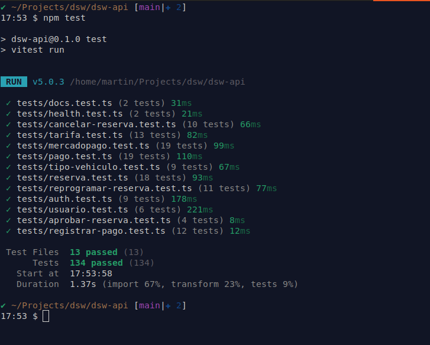

# DSW API: gestión de reservas de estacionamiento

API REST del trabajo práctico de **Desarrollo de Software** (UTN). Gestiona usuarios (administradores y clientes), playas de estacionamiento, cocheras, tarifas, reservas y pagos.

- Propuesta del TP: [tp-dsw/proposal.md](https://github.com/mapszk/tp-dsw/blob/main/proposal.md)
- Frontend: [mapszk/dsw-frontend](https://github.com/mapszk/dsw-frontend)
- Documentación del proyecto: [docs/README.md](docs/README.md)
- Video demo de la aplicación: [YouTube](https://youtu.be/bgZAVnIS35E)

## Índice

1. [Stack tecnológico](#stack-tecnológico)
2. [Aplicación desplegada](#aplicación-desplegada)
3. [Usuarios de prueba](#usuarios-de-prueba)
4. [Instalación y ejecución local (Docker)](#instalación-y-ejecución-local-docker)
5. [Variables de entorno](#variables-de-entorno)
6. [Tests](#tests)
7. [Ejecución sin Docker para la API](#ejecución-sin-docker-para-la-api)
8. [Comandos útiles](#comandos-útiles)
9. [Estructura del proyecto](#estructura-del-proyecto)
10. [Reglas del equipo](#reglas-del-equipo)

## Stack tecnológico

- Node.js 22 + TypeScript
- Express 5
- PostgreSQL 16
- Prisma 7
- Zod
- Vitest + Supertest
- ESLint + Prettier
- Docker + Docker Compose

## Aplicación desplegada

| Servicio                   | URL                                   |
| -------------------------- | ------------------------------------- |
| Frontend (Vercel)          | https://dsw-frontend-blush.vercel.app |
| API (Render)               | https://dsw-api.onrender.com/api      |
| Documentación (Swagger UI) | https://dsw-api.onrender.com/api/docs |

La API está en el plan gratuito de Render: después de un rato sin uso se suspende y el primer pedido puede tardar alrededor de un minuto en responder.

## Usuarios de prueba

El seed carga estos usuarios, disponibles tanto en la aplicación desplegada como en local después de ejecutar `npm run db:seed`:

| Rol           | Correo          | Contraseña |
| ------------- | --------------- | ---------- |
| Administrador | admin@dsw.com   | dsw12345   |
| Cliente       | cliente@dsw.com | dsw12345   |

Para probar los pagos online con MercadoPago, al pagar una reserva iniciar sesión en MercadoPago con esta cuenta de prueba (comprador) y/o usar las [tarjetas de prueba de MP](https://www.mercadopago.com.ar/developers/es/docs/checkout-pro/additional-content/your-integrations/test/cards):

| Cuenta MercadoPago | Usuario                    | Contraseña |
| ------------------ | -------------------------- | ---------- |
| Comprador          | TESTUSER354153819273760519 | 6Sxk6O1Q8o |

## Instalación y ejecución local (Docker)

**1. Clonar el repositorio**

```bash
git clone https://github.com/mapszk/dsw-api.git
cd dsw-api
```

**2. Crear el archivo de variables de entorno**

```bash
cp .env.example .env
```

**3. Levantar la aplicación**

```bash
docker compose up -d --build
```

Esto construye la imagen de la API, levanta PostgreSQL, espera a que la base esté lista, aplica las migraciones y arranca la API en modo desarrollo (se recarga sola al editar archivos de `src/`).

**4. Cargar datos iniciales (seed)**

```bash
docker compose exec api npm run db:seed
```

**5. Documentación de la API**

Con la API levantada, la documentación interactiva (Swagger UI) queda en http://localhost:3000/api/docs. La especificación OpenAPI está en [docs/openapi.yaml](docs/openapi.yaml).

Para probar endpoints protegidos desde Swagger, primero ejecutar `POST /auth/login` (por ejemplo con `admin@dsw.com` / `dsw12345`): la cookie de sesión queda guardada y se usa en los siguientes pedidos.

**6. Pagos con MercadoPago (opcional)**

Sin credenciales la API funciona igual, pero iniciar un pago con MercadoPago responde 503. Para probarlo en local:

1. En [MP Developers](https://www.mercadopago.com.ar/developers/panel) crear una aplicación y dos cuentas de prueba (vendedor y comprador).
2. Con la cuenta vendedora, copiar el Access Token de prueba en `MP_ACCESS_TOKEN`.
3. Exponer la API con un túnel (`ngrok http 3000`) y poner la URL pública, sin `/api`, en `API_PUBLIC_URL`.
4. En la aplicación de MP, configurar el webhook de **Pagos** con `<API_PUBLIC_URL>/api/webhooks/mercadopago` y copiar la clave secreta en `MP_WEBHOOK_SECRET`.
5. Reiniciar la API, iniciar el pago de una reserva activa (`POST /reservas/{id}/pagar` con `{ "metodo": "ONLINE" }`) y pagar en el link devuelto con la cuenta compradora y las tarjetas de prueba de MP.

## Variables de entorno

Se configuran en el archivo `.env` (copiado de `.env.example`). La API las valida al arrancar y, si falta alguna obligatoria o tiene un formato inválido, muestra el error y no inicia.

| Variable                          | Obligatoria | Valor por defecto       | Descripción                                                                                                       |
| --------------------------------- | ----------- | ----------------------- | ----------------------------------------------------------------------------------------------------------------- |
| `NODE_ENV`                        | No          | `development`           | Entorno de ejecución: `development`, `test` o `production`.                                                       |
| `PORT`                            | No          | `3000`                  | Puerto donde escucha la API.                                                                                      |
| `POSTGRES_USER`                   | Con Docker  |                         | Usuario de PostgreSQL. Docker Compose lo usa para crear la base.                                                  |
| `POSTGRES_PASSWORD`               | Con Docker  |                         | Contraseña de PostgreSQL.                                                                                         |
| `POSTGRES_DB`                     | Con Docker  |                         | Nombre de la base de datos.                                                                                       |
| `POSTGRES_PORT`                   | No          | `5432`                  | Puerto de PostgreSQL expuesto en la máquina local.                                                                |
| `DATABASE_URL`                    | Sí          |                         | URL de conexión de Prisma. Con Docker Compose se arma sola a partir de las variables `POSTGRES_*`.                |
| `JWT_SECRET`                      | Sí          |                         | Clave para firmar los tokens de sesión. Mínimo 32 caracteres; en producción usar un valor aleatorio.              |
| `JWT_EXPIRES_IN`                  | No          | `8h`                    | Duración de la sesión (formato de `jsonwebtoken`: `8h`, `1d`, etc.).                                              |
| `MP_ACCESS_TOKEN`                 | No          |                         | Access Token de MercadoPago. Sin él, iniciar un pago online responde 503.                                         |
| `MP_WEBHOOK_SECRET`               | No          |                         | Clave secreta del webhook de MercadoPago, para verificar los avisos de pago.                                      |
| `API_PUBLIC_URL`                  | No          | `http://localhost:3000` | URL pública de la API (sin `/api`) a la que MercadoPago envía los avisos de pago.                                 |
| `FRONTEND_URL`                    | No          | `http://localhost:5173` | URL del frontend a la que vuelve el cliente después de pagar en MercadoPago.                                      |
| `PAGO_ONLINE_VENCIMIENTO_MINUTOS` | No          | `15`                    | Minutos de validez del link de pago online. Mientras está vigente, la reserva no se puede cobrar de forma manual. |

## Tests

Los tests usan Vitest + Supertest y mockean Prisma, así que no necesitan la base de datos levantada:

```bash
npm install
npm test
```

Con Docker también se pueden correr dentro del contenedor: `docker compose exec api npm test`.

Resultado de la ejecución:


