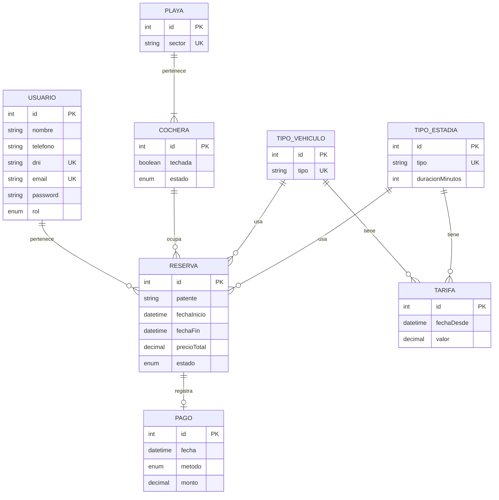

# Documentación: DSW API

Punto de entrada de la documentación del backend, según los requisitos de la cátedra.

## Pull requests

PRs mergeados a `main`:

- [#1 Configuracion inicial de la API](https://github.com/mapszk/dsw-api/pull/1)
- [#2 CRUD de tipos de estadia y reservas](https://github.com/mapszk/dsw-api/pull/2)
- [#3 Agrega CRUD de usuarios, tipos de vehiculo y tarifas, login con JWT y reprogramar reserva](https://github.com/mapszk/dsw-api/pull/3)
- [#4 Proteger rutas](https://github.com/mapszk/dsw-api/pull/4)
- [#5 Flujo de reservas: aprobar y registrar pago](https://github.com/mapszk/dsw-api/pull/5)
- [#6 Documentacion de la API](https://github.com/mapszk/dsw-api/pull/6)
- [#7 Agrega estados de pago y reglas del CRUD de pagos](https://github.com/mapszk/dsw-api/pull/7)
- [#8 Implementar pagos externos con SDK de MercadoPago](https://github.com/mapszk/dsw-api/pull/8)
- [#9 Impide eliminar un pago online en curso](https://github.com/mapszk/dsw-api/pull/9)
- [#10 corregir carga de tarifas en seed](https://github.com/mapszk/dsw-api/pull/10)

## Modelo de datos

DER corregido por la cátedra. Diferencias en la implementación:

- `Usuario.rol` (`ADMIN` | `CLIENTE`): necesario para los 2 niveles de acceso.
- `TipoEstadia.duracionMinutos`: necesario para calcular el precio total de la reserva.
- `Usuario` - `Reserva` es 0..N del lado de la reserva (un administrador no tiene reservas).

